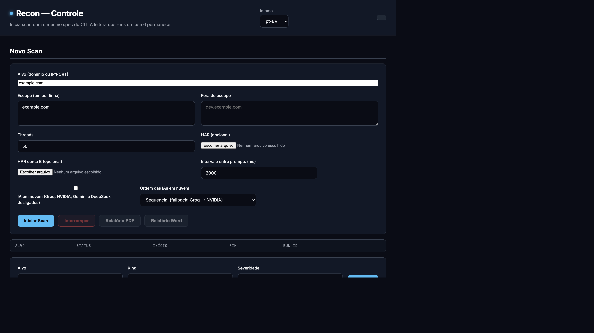

# Recon-AI

Reconhecimento autorizado em container: ferramentas pinadas, allowlist obrigatória, SQLite, dorks no motor de busca, correlação `corr/…` e uma IA no fim do scan. O padrão é Ollama local (`qwen2.5:7b`); Google AI Studio só entra com `--cloud`. HAR de browser é opcional. Findings entram no catálogo `reportable` | `note` | `coverage`: a IA classifica só o reportável e grava rascunhos de bounty em `drafts/`.

O host só precisa do Docker. A imagem é Debian 13 com versões em `versions.lock`.

Interface web (opcional, `127.0.0.1:8765`):



**Documentação de produto:** [documentation/README.md](documentation/README.md). Word consolidado: [documentation/Recon_AI_Documentacao_Consolidada.docx](documentation/Recon_AI_Documentacao_Consolidada.docx).

Repositório GitHub (público): `batistasamuel/pipeline-recon-ai`. Branch padrão: `main`.

---

## Versionamento e ambientes

Três ambientes, um por branch:

| Branch | Ambiente | Como chega código |
| --- | --- | --- |
| `dev` | DEV | PR a partir de `feature/*`, `fix/*`, `chore/*` ou `backport/*` |
| `hml` | HML (homologação) | PR a partir de `dev` ou `backport/*` |
| `main` | PRD (produção) | PR a partir de `hml` ou `hotfix/*` |

Branches de trabalho: `feature/*`, `fix/*`, `chore/*` nascem de `dev`. `hotfix/*` nasce de `main`. `backport/*` leva hotfix de volta para `hml` e `dev`.

Promoção **sempre via Pull Request**, nunca push direto:

`feature/*` → `dev` → `hml` → `main`

### Método de merge (convenção)

No plano Free não dá para fixar o método por branch. As três opções estão ligadas no repositório. A convenção é:

- **Squash merge** em PRs `feature/*`, `fix/*`, `chore/*` → `dev`
- **Merge commit** em PRs `dev` → `hml` e `hml` → `main` (preserva o histórico de promoção)
- Rebase merge está **desligado** no repositório
- Branches do PR **não** são apagadas após o merge (`delete-branch-on-merge` está desligado no repositório)

Isto é convenção/guardrail, não proteção técnica.

### Guardrails locais (hooks)

Push direto em `dev`, `hml` e `main` é bloqueado **neste clone** por um hook em `.githooks/pre-push`. O setup do clone (abaixo) ativa esse hook.

Bypass consciente, só em emergência documentada:

```bash
ALLOW_PROTECTED_PUSH=1 git push …
```

Quem clonar e não rodar `./scripts/setup-hooks.sh` **não** tem esse bloqueio. O hook não vale para merge pela interface web do GitHub.

### GitHub Actions

Não há chave `environment:` nos workflows (GitHub Environments indisponíveis neste plano). Minutos do plano Free são limitados; os workflows usam `concurrency` e passos enxutos.

| Workflow | Quando | Papel |
| --- | --- | --- |
| `ci.yml` | PR e push em `dev`, `hml`, `main` | Job `CI` — lint/test (TODO de stack) |
| `promotion-guard.yml` | PR para `dev`, `hml`, `main` | Job `Promotion Guard` — falha se a origem violar o fluxo |
| `deploy-nonprod.yml` | Push em `dev` ou `hml` | Deploy DEV/HML (TODO) com secrets `DEV_*` / `HML_*` |
| `release.yml` | Tag `v*.*.*` | Confere que o commit está em `main` e cria GitHub Release |
| `deploy-prd.yml` | Só `workflow_dispatch` | Deploy PRD (TODO) com secrets `PRD_*`; exige `confirm=DEPLOY-PRD` |

O Promotion Guard é um **aviso visível**. Sem branch protection, o GitHub **não impede** o merge com o check vermelho. Olhe o resultado antes de mesclar.

### Secrets e variables

Sem GitHub Environments. Cadastre no **repositório**, com prefixo por ambiente.

```bash
gh secret set DEV_EXEMPLO
gh secret set HML_EXEMPLO
gh secret set PRD_EXEMPLO
gh variable set DEV_EXEMPLO
gh variable set HML_EXEMPLO
gh variable set PRD_EXEMPLO
```

Tabela para registro (sem valores):

| Nome | Tipo | Ambiente | Para que serve | Cadastrado |
| --- | --- | --- | --- | --- |
| `DEV_GEMINI_API_KEY` | secret | DEV | Google AI Studio (`--cloud`) | |
| `HML_GEMINI_API_KEY` | secret | HML | Google AI Studio (`--cloud`) | |
| `PRD_GEMINI_API_KEY` | secret | PRD | Google AI Studio (`--cloud`) | |
| `DEV_GROQ_API_KEY` | secret | DEV | Groq (`--cloud`) | |
| `HML_GROQ_API_KEY` | secret | HML | Groq (`--cloud`) | |
| `PRD_GROQ_API_KEY` | secret | PRD | Groq (`--cloud`) | |
| `DEV_DEEPSEEK_API_KEY` | secret | DEV | DeepSeek (`--cloud`) | |
| `HML_DEEPSEEK_API_KEY` | secret | HML | DeepSeek (`--cloud`) | |
| `PRD_DEEPSEEK_API_KEY` | secret | PRD | DeepSeek (`--cloud`) | |
| `DEV_NVIDIA_API_KEY` | secret | DEV | NVIDIA NIM (`--cloud`) | |
| `HML_NVIDIA_API_KEY` | secret | HML | NVIDIA NIM (`--cloud`) | |
| `PRD_NVIDIA_API_KEY` | secret | PRD | NVIDIA NIM (`--cloud`) | |

### Versionamento (SemVer)

Tags `vMAJOR.MINOR.PATCH` **somente em `main`**, depois de cada promoção para PRD. O workflow `release.yml` recusa tag cujo commit não esteja em `main`.

### Do clone até a produção

Caminho único, na ordem: clonar e preparar a máquina → desenvolver em `dev` (`feature/*` ou `fix/*`) → promover e testar em HML → promover a `main` e disparar PRD. Trabalho diário **nunca** começa em `main`.

Mensagens de commit em inglês ([Conventional Commits](https://www.conventionalcommits.org/)): `feat:`, `fix:`, `chore:`. Documentação em português (BR). Use o template de PR e a label correspondente (`feature`, `fix`, `chore`, `promotion`, `hotfix`, `backport`).

#### 1. Clonar e setup

Clone a branch padrão (`main`):

```bash
gh repo clone batistasamuel/pipeline-recon-ai
cd pipeline-recon-ai
./scripts/setup-hooks.sh
```

`./scripts/setup-hooks.sh` define `git config core.hooksPath .githooks` **só neste clone**. Sem esse passo, o Git aceita `git push` direto em `dev` / `hml` / `main`.

Dependência de runtime: Docker (Compose). Na raiz do repositório:

```bash
cp scope/scopes.txt.example scope/scopes.txt
# edite scope/scopes.txt: só alvos com autorização escrita

PUID="$(id -u)" PGID="$(id -g)" docker compose build
PUID="$(id -u)" PGID="$(id -g)" docker compose run --rm recon --check
docker compose up -d ollama
docker compose exec ollama ollama pull qwen2.5:7b
```

`--check` não consulta alvo: só confere binários e templates contra `versions.lock` (exit 4 se divergir).

Chaves de API opcionais (não versionadas): `config/subfinder/provider-config.yaml`, `config/amass/config.ini`, `config/gau.toml`. Detalhe de scan, códigos de saída e UI: seções **Uso autorizado** em diante.

Antes de cada ciclo de trabalho:

```bash
git checkout dev
git pull origin dev
```

#### 2. Feature nova (`feature/*` → DEV)

```bash
git checkout dev
git pull origin dev
git checkout -b feature/assunto-curto
```

Implemente, rode o que couber localmente (hoje: `--check`, `--dry-run`, testes em `tests/` quando existirem; o job `CI` ainda é placeholder). Atualize `CHANGELOG.md` se a mudança for visível.

```bash
git add -p
git commit -m "feat: short description"
git push -u origin feature/assunto-curto
gh pr create --base dev --head feature/assunto-curto --label feature --title "feat: …"
```

Antes do merge: CI e **Promotion Guard** verdes (origem tem que ser `feature/*`, `fix/*`, `chore/*` ou `backport/*`). Método de merge: **squash**. Não mescle com check vermelho — o GitHub Free não impede, a convenção sim.

O merge em `dev` dispara `deploy-nonprod.yml` (deploy DEV ainda é TODO). Até o deploy existir, valide nesta máquina a partir de `dev`:

```bash
git checkout dev
git pull origin dev
PUID="$(id -u)" PGID="$(id -g)" docker compose build
PUID="$(id -u)" PGID="$(id -g)" docker compose run --rm recon --check
```

Manutenção sem comportamento novo usa `chore/assunto` no mesmo fluxo (label `chore`, commit `chore:`).

#### 3. Correção de bug (`fix/*` → DEV)

Igual à feature, com nomes e label de correção. Não abra `hotfix/*` a menos que o defeito **já esteja em PRD** (`main`); bug só em `dev` ou `hml` sai de `dev` via `fix/*`.

```bash
git checkout dev
git pull origin dev
git checkout -b fix/assunto-curto
# … correção, changelog se couber …
git commit -m "fix: short description"
git push -u origin fix/assunto-curto
gh pr create --base dev --head fix/assunto-curto --label fix --title "fix: …"
```

Squash para `dev` depois de CI e Promotion Guard. Só então promova o `dev` atualizado para HML (passo 4) — não abra PR `fix/*` direto para `hml` ou `main`.

#### 4. Homologação (DEV → HML)

Quando `dev` tiver o conjunto a homologar (uma ou várias features/fixes já em `dev`):

```bash
git fetch origin
gh pr create --base hml --head dev --label promotion --title "promotion: DEV → HML"
```

Promotion Guard: origem tem que ser `dev` (ou `backport/*`). Método de merge: **merge commit** (não squash). Conferir CI e Promotion Guard.

O push em `hml` dispara `deploy-nonprod.yml` com prefixo `HML_*` (passos ainda TODO). Homologue de verdade neste intervalo:

1. Esperar o workflow de deploy HML (quando existir) ou, até lá, fazer checkout de `hml` e subir o stack localmente como no setup.
2. Exercitar o fluxo que a mudança altera (scan `--dry-run` / run autorizado, UI em `127.0.0.1:8765` se for o caso, `--check`).
3. Se HML falhar: `fix/*` a partir de `dev`, squash em `dev`, **novo** PR `dev` → `hml`. Não “remende” `hml` com push direto nem com PR `feature/*` para `hml`.
4. Só promova a PRD com HML aceita.

#### 5. Produção (HML → PRD)

Checklist curto na subseção seguinte. Resumo: PR `hml` → `main` (merge commit) → tag SemVer **em `main`** → GitHub Release → **Deploy PRD** manual (`confirm=DEPLOY-PRD`). Não há deploy automático em `main`.

#### Promoção normal (DEV → PRD)

1. Branch `feature/*` (ou `fix/*` / `chore/*`) a partir de `dev`. PR para `dev`, squash merge, conferir CI e Promotion Guard.
2. PR `dev` → `hml`, merge commit. Conferir CI, Promotion Guard e **testes em HML** (passo 4). O push em `hml` dispara deploy HML quando o TODO estiver implementado.
3. PR `hml` → `main`, merge commit.
4. Em `main`: `git tag vX.Y.Z` e `git push origin vX.Y.Z`. Aguardar a GitHub Release.
5. Actions → **Deploy PRD** → `workflow_dispatch` com `tag=vX.Y.Z` e `confirm=DEPLOY-PRD`.

#### Hotfix

1. `hotfix/*` a partir de `main`. PR para `main` (Promotion Guard aceita). Merge. Tag + Release + Deploy PRD.
2. `backport/*` a partir do commit/tag do hotfix. PRs para `hml` e para `dev` (Promotion Guard aceita `backport/*` nos dois destinos).

### Limitações do plano Free

O que **não** é imposto tecnicamente (é convenção/guardrail):

- Push direto em `dev` / `hml` / `main` pela web, por outro clone sem o hook, ou com `ALLOW_PROTECTED_PUSH=1`
- Merge de PR com CI ou Promotion Guard vermelhos
- Ordem de promoção (`dev` → `hml` → `main`); o GitHub não a força
- Método de merge (squash vs merge commit) por destino
- CODEOWNERS como required reviewers
- Isolamento de secrets por ambiente (tudo é secret/variable de repositório; o prefixo `DEV_` / `HML_` / `PRD_` é convenção)

O que um plano pago habilitaria:

- **GitHub Pro (repositório privado):** branch protection / rulesets (exigir PR, exigir checks, bloquear push direto); GitHub Environments com secrets por ambiente e restrição de branch
- **Enterprise, ou repositório público:** required reviewers em Environment (o “aprovar produção” nativo). Neste plano Free o equivalente é disparar `deploy-prd.yml` à mão com `confirm=DEPLOY-PRD`

Não foram configurados branch protection, rulesets nem GitHub Environments — não estão disponíveis de forma útil neste cenário e não devem ser tentados.

---

## Uso autorizado

Só em ativos com autorização escrita (bug bounty ou contrato). `scope/scopes.txt` é controle técnico, não substituto jurídico.

## Preparar (escopo do scan)

O clone, os hooks e o Docker estão no passo **1. Clonar e setup**. Aqui só o alvo:

```bash
cp scope/scopes.txt.example scope/scopes.txt
```

Um alvo autorizado por linha (domínio ou `IP:PORT`). Sem esse arquivo, ou com alvo ausente, o comando sai com código 3.

Chaves de API (opcional), montadas só para leitura:

- `config/subfinder/provider-config.yaml`
- `config/amass/config.ini`
- `config/gau.toml`

## Build e conferência

```bash
PUID="$(id -u)" PGID="$(id -g)" docker compose build
PUID="$(id -u)" PGID="$(id -g)" docker compose run --rm recon --check
docker compose up -d ollama
docker compose exec ollama ollama pull qwen2.5:7b
```

`--check` confere checksum e versão dos binários e o commit dos templates do Nuclei. Não consulta alvo. Exit 4 se a imagem divergir do lockfile.

O Dockerfile descreve amd64 e arm64; a prova da segunda arquitectura espera o job `CI` (ainda placeholder).

## Executar

Corra os comandos **na raiz deste repositório** (o `compose.yaml` tem o serviço `recon`).

```bash
PUID="$(id -u)" PGID="$(id -g)" docker compose run --rm recon example.com --dry-run
PUID="$(id -u)" PGID="$(id -g)" docker compose run --rm recon example.com
PUID="$(id -u)" PGID="$(id -g)" docker compose run --rm recon example.com --har /scope/captura.har
PUID="$(id -u)" PGID="$(id -g)" docker compose run --rm recon example.com --cloud
PUID="$(id -u)" PGID="$(id -g)" docker compose run --rm recon example.com --verify
PUID="$(id -u)" PGID="$(id -g)" docker compose run --rm recon example.com --threads 40 --disable gau
PUID="$(id -u)" PGID="$(id -g)" docker compose run --rm recon example.com --disable dorks
PUID="$(id -u)" PGID="$(id -g)" docker compose run --rm recon resume RUN_ID
PUID="$(id -u)" PGID="$(id -g)" docker compose run --rm recon stop RUN_ID
PUID="$(id -u)" PGID="$(id -g)" docker compose run --rm recon ai RUN_ID
PUID="$(id -u)" PGID="$(id -g)" docker compose run --rm recon ai RUN_ID --cloud
PUID="$(id -u)" PGID="$(id -g)" docker compose run --rm recon export RUN_ID --format pdf
PUID="$(id -u)" PGID="$(id -g)" docker compose run --rm recon export RUN_ID --draft CLUSTER_KEY --format pdf
```

`--dry-run` mostra o plano (fases incluindo `ai`) e não consulta a rede. `--threads` é 1–200. `config/recon.yaml` pode limitar threads, rate do Nuclei e timeout do Amass. `--cloud` envia classificação, rotas, stack e rascunho (já mascarados) ao Google AI Studio; exige `GEMINI_API_KEY`. `--verify` liga checagens passivas na fase `ai` (CNAME, HEAD sem sessão, fingerprint no disco); o default é `skip`.

O default é o orquestrador Python. Fases de coleta: `subdomains` → `dns` → `http` → `urls` → `dorks` → `js` → `nuclei` → `report`. Depois: `har` (opcional), `correlate`, `ai`. Hosts 401/403 entram no SQLite e no resumo e não seguem para Katana nem Nuclei. O script Bash só corre com `RECON_ENGINE=bash`.

`--har /scope/captura.har` (ou upload na UI) lê `log.entries` uma a uma (`iter_har_entries`; teto 32 MB) e só aproveita entradas cujo host passa em `url_allowed` — o mesmo `in_scope` do scan. Um HAR de outro host autorizado em `scopes.txt` mas ausente do spec deste run conta como fora do escopo (0 URLs, 0 JS). Nuclei sem sessão nas URLs da captura: cap 50, lotes de 10, `-max-host-error 3`.

Cada scan grava `results/recon.db` e `results/recon_<alvo>_<UTC>/`. O comando imprime `run_id`. `resume` continua a primeira fase que não está `ok`/`skip`. Runs `running` órfãos (e fases `running`) passam a `failed`/`fail` no comando seguinte, na subida da UI e antes de aceitar um scan novo.

`results/state/home` recebe cópias graváveis da configuração. `/config` continua só leitura.

Amass passivo: 5 minutos (`tools.amass.timeout_minutes`). stderr em `logs/`.

### Códigos de saída

| Código | Motivo |
| --- | --- |
| 0 | Run `ok`, dry-run ou `--check` |
| 1 | Fase crítica falhou, ingest inválido ou IA falhou |
| 2 | Alvo/threads/job inválidos; `--webhook`; `--cloud` sem chave |
| 3 | Alvo ausente do escopo |
| 4 | Binário ou template divergente do lockfile |

## IA

O scan completo, depois de `correlate`, chama o modelo: classifica só clusters **reportáveis**, tenta rotas nos JS baixados, resume fingerprints (`tech`) e monta rascunhos em `drafts/<cluster_key>.md`. Note e coverage ficam em `clusters.json`, fora do prompt de classificação. `recon ai RUN_ID` refaz só essa fase.

Sem findings reportáveis e sem JS com path entre aspas começando por `/`, grava JSON vazio e não fala com o modelo. JS único (SHA-256) em partes de 20 000 caracteres, overlap 400. Classificação em lotes que cabem em `num_predict`. Schema inválido não é publicado. Transporte aborta a fase.

Padrão: Ollama (`qwen2.5:7b`), sem retry de transporte. `--cloud` envia classificação, rotas e stack à nuvem depois de trocar hosts/IPs por tokens. Ativos: Groq e NVIDIA. Gemini e DeepSeek estão desligados por enquanto. `--cloud-mode sequential` (padrão) tenta Groq e depois NVIDIA; `parallel` distribui os prompts. `--ai-delay-ms` (padrão 2000) espera entre uma resposta e o próximo prompt, também no Ollama. Sem chave ativa a fase `ai` falha. **Não há fallback silencioso** para o Ollama.

`recon ai RUN_ID` usa Ollama mesmo se o scan original tinha `--cloud` (a flag do comando vale, default falso). Para insistir na nuvem: `recon ai RUN_ID --cloud`. Consultar a IA na UI continua no Ollama.

`LLAMA_ARG_CACHE_RAM=0` no serviço ollama evita o cache default de 8 GB do llama.cpp no Docker.

Detalhe: [documentation/ai/architecture.md](documentation/ai/architecture.md). ADR-018: [documentation/decisions/ADR-018-reportable-vs-nota.md](documentation/decisions/ADR-018-reportable-vs-nota.md).

## Diff

No fim de um run `ok`, comparação com o `ok` anterior do mesmo alvo (entrou / saiu / mudou). `--webhook` não faz parte desta fase.

## UI

```bash
PUID="$(id -u)" PGID="$(id -g)" docker compose --profile ui up ui
```

`http://127.0.0.1:8765` — inicia scan (mesmo spec do CLI, incluindo checkbox de nuvem), HAR opcional, fluxo ao vivo, stop, **apagar** run parado (lixeira; recusa `running`), export PDF/Word, **Rascunhos** (`draft` | `ready` | `rejected`), **Consultar a IA** (prompt livre, bloqueado se houver scan `running`), classificação, **Candidatos** (`corr/…`) e checklist bug bounty. Um scan de cada vez: o botão Iniciar fica desabilitado enquanto houver `running`. A UI colhe runs órfãos na subida. A página é HTML/CSS estático em `recon_ai/ui_page.html`, relida a cada GET (após mudar o arquivo: rebuild ou `docker cp` + restart da UI).

## O que a imagem contém

Releases com checksum: subfinder 2.16.0, dnsx 1.3.1, httpx 1.12.0, katana 1.7.0, nuclei 3.11.1, gau 2.2.4, Amass 4.2.0, go-dork 1.0.3.

- Amass 5.1.1 só enumera via engine em `127.0.0.1:4000`; a imagem usa 4.2.0.
- assetfinder 0.1.1: commit `4e95d870`.
- waybackurls 0.1.0: `go install` nos dois archs.
- go-dork 1.0.3: binário de release com checksum (amd64/arm64).
- Templates Nuclei 10.4.9: commit `893122ff`.

A imagem final não traz o compilador Go.

## Relação com o script Bash

O domínio/alvo é validado antes de criar o run. A contagem do Nuclei sai do JSONL. Falha de dnsx, httpx, go-dork ou Nuclei encerra o run. Wildcard DNS existe. Nomes e URLs só entram no alvo ou abaixo dele (com `in_scope`/`out_scope`). Não se cria `screenshots`.
