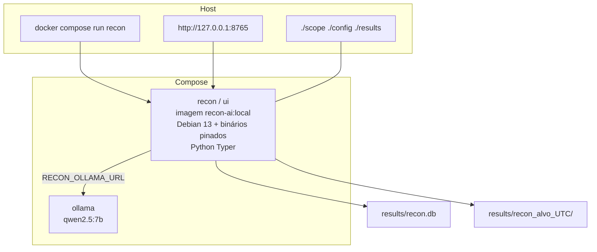

# Arquitetura atual

O contrato de execução continua a ser Docker Compose. O host não instala Go nem as ferramentas de recon.

## Componentes e por que existem

| Componente | Função | Evidência |
| --- | --- | --- |
| Imagem `recon-ai:local` | Isola ferramentas e o orquestrador | `Dockerfile`, `versions.lock` |
| Serviço `recon` | CLI: scan, resume, stop, ai, export, `--check` | `compose.yaml`, `recon_ai/cli.py` |
| Serviço `ollama` | Inferência local | `compose.yaml`; digest em `versions.lock` |
| Serviço `ui` (profile `ui`) | HTTP 8765, inicia scan, HAR, Consultar a IA, Candidatos, Rascunhos, DELETE | `recon_ai/ui.py`, `ui_page.html` |
| Pipeline | Fases `SCAN_PHASES` (inclui `dorks`) | `recon_ai/pipeline.py` |
| HAR / derive / correlate | Captura opcional (entries em streaming), fingerprints, joins `corr/…` | `har.py`, `derive.py`, `correlate.py` |
| Catálogo / rascunhos / verify | Classe do finding, markdown bounty, checagens passivas | `catalog.py`, `cluster.py`, `drafts.py`, `verify.py` |
| Store SQLite | Memória entre runs | `recon_ai/db.py` |
| Análise | Schema + Ollama; Gemini se `spec.cloud` | `recon_ai/ai.py`, `gemini.py`, `runner.analyze_run` |

## Relação com a visão original

A visão do guia era: `docker compose run` → container recon → ollama **somente perfil ai**. Hoje `ollama` não tem profile e o scan completo chama a IA. A UI deixou de ser só leitura.

Não há broker. Um scan de cada vez na UI (`SCAN_LOCK`). CLI pode criar outro container em paralelo — a UI recusa se já existe `running` no SQLite.

## Caminho de dados

1. `refuse_scope` + `valid_target`.
2. `Pipeline` escreve artefatos e `phases.tsv` (`SCAN_PHASES`, incluindo `dorks`).
3. `record(..., finish=False)` ingere assets/URLs/Nuclei.
4. Fase `har` (opcional) e `correlate` (`corr/findings.jsonl`) antes da IA.
5. `analyze_run` fala com Ollama (ou Gemini se `--cloud`), classifica só reportável, grava `ai_result`, `drafts/` e manifest. `--verify` anota `evidence.verified`.
6. `finish_recorded` fecha o run e, se `ok`, escreve delta.

Detalhe: [data-flow.md](data-flow.md), [execution-flow.md](execution-flow.md).
