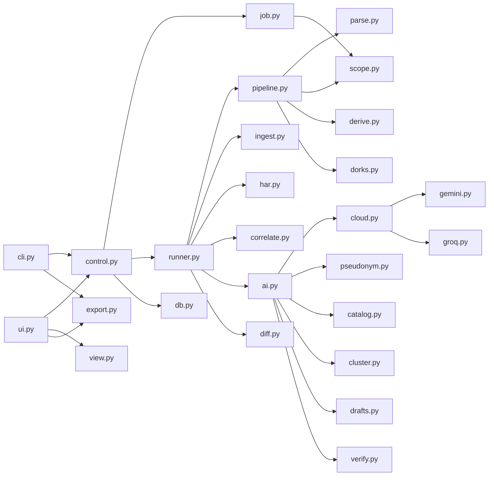

# Diagrama de componentes

Módulos Python reais em `recon_ai/` (não há pacote `adapters/`).

| Módulo | Responsabilidade |
| --- | --- |
| `cli.py` | Typer: `run`, `resume`, `stop`, `ai`, `export`, `--check`, `--cloud`, `--verify`, `--draft` |
| `control.py` | Escopo, spec, `run_job`, `stop_run` |
| `job.py` | Catálogo de 13 ferramentas (inclui `dorks`), `normalize_spec` |
| `pipeline.py` | Execução das fases de coleta |
| `dorks.py` | Queries + `go-dork` + parse de hits |
| `derive.py` | Fingerprints, provenance, buckets, secrets JS redactados |
| `har.py` | Ingestão opcional de HAR (≤ 32 MB, `iter_har_entries`) |
| `catalog.py` | `template_id` → `reportable` \| `note` \| `coverage` |
| `cluster.py` | `cluster_key` + `clusters.json` |
| `drafts.py` | `drafts/*.md` + `index.json` |
| `verify.py` | Checagens passivas opt-in |
| `gemini.py` | Google AI Studio; retry HTTP 429/503 |
| `correlate.py` | Joins A∧B → `corr/findings.jsonl` + checklist |
| `parse.py` | Nomes, URLs, HTTP, JS regex, Nuclei JSONL |
| `scope.py` | Validação de alvo, allowlist, loopback |
| `runner.py` | Engine python/bash, ingest, har, correlate, `analyze_run` |
| `ai.py` | Cliente Ollama, schema, chunking, lotes de classificação |
| `cloud.py` | `--cloud`: Groq e NVIDIA ativos; Gemini/DeepSeek desligados |
| `gemini.py` / `groq.py` / `nvidia.py` | Clientes HTTP da nuvem |
| `pseudonym.py` | Tokens de host/IP antes do envio |
| `db.py` | Schema SQLite; `delete_run`; `reap_stale_runs` também falha fases `running` |
| `diff.py` | Delta vs último `ok` |
| `view.py` / `ui.py` / `ui_page.html` | Leitura e controlo HTTP; HTML relido a cada GET |
| `export.py` | PDF (reportlab 4.4.4) e Word (python-docx 1.2.0) |
| `config.py` | `recon.yaml` (threads / rate / amass) |
| `settings.py` | Variante antiga de settings; **não** é o caminho de `control.settings_or_error` |
| `runtime.py` | Cópia de configs para HOME gravável |
| `plan.py` | Texto do dry-run e argv do Bash |

Binários: subfinder, amass, assetfinder, dnsx, httpx, katana, gau, waybackurls, go-dork, nuclei, curl, timeout. crt.sh é `curl` + JSON.
