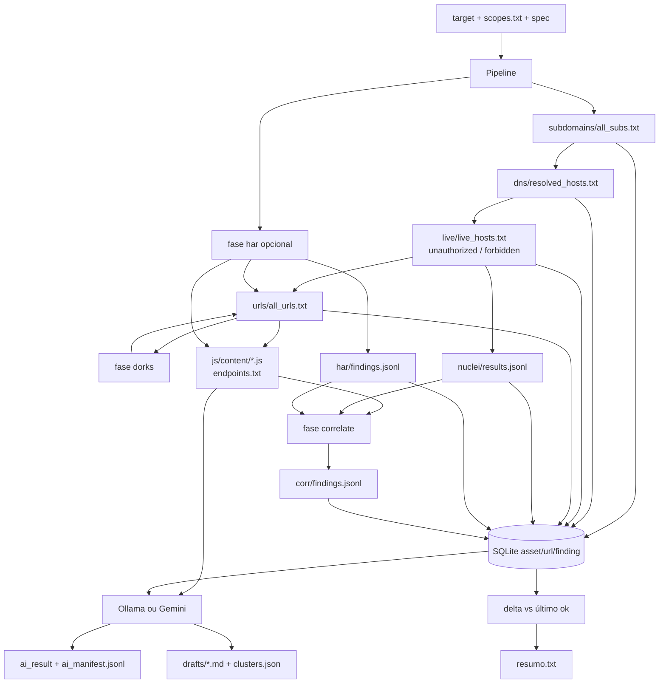

# Fluxo de dados

## Regras de filtragem (parser)

- Nome: host é o alvo ou um rótulo abaixo; `out_scope` remove; IPv4 literal aceita o próprio host e o alias de loopback.
- URL: `host_matches_target` — porta do alvo importa (`127.0.0.1` ≠ `127.0.0.1:8080`).
- HTTP: 2xx/3xx → live (Katana/Nuclei); 401 e 403 ficam no SQLite e **não** seguem.
- JS regex (`ENDPOINT`): `/api/…` ou `/vN/…`. Independente da IA.
- Nuclei: só JSONL; cada linha vira `finding`.
- HAR (opcional): `log.entries` lidas uma a uma (`iter_har_entries`); filtradas por `url_allowed`; JS em `js/content`; findings graves em `har/findings.jsonl` (`har/cors`, `har/secret`, `har/jwt-none`, `har/retire`). Sem arquivo a fase é `skip`. Tamanho máximo 32 MB. Terceiros do browser não entram. Nuclei sem sessão nas URLs HAR: cap 50, lotes de 10, `-max-host-error 3`.
- Dorks: queries geradas do alvo/fingerprints (teto 24); `go-dork` pinado (Bing por padrão); hits filtrados por escopo; httpx no URL; merge em `all_urls` + provenance `dorks`. `--disable dorks` → `skip`. Shodan sem chave → `fail`.
- Correlate: joins A∧B em `corr/findings.jsonl` (candidatos `info`/`low`; dupla evidência pode ser `high`). A IA classifica só `corr/…` **reportáveis**.
- Catálogo: `kind`/`class`/`cluster_key` no ingest. Note e coverage não entram no prompt de classificação.
- `--verify` (na fase `ai`): CNAME, HEAD sem cookie/Authorization do HAR, fingerprint do segredo no disco. Default `skip`.
- Provenance: `urls/provenance.tsv` (`katana|gau|waybackurls|har|dorks`). Fingerprints: `live/fingerprints.jsonl`. Buckets regex em `urls/buckets/` (idor, swagger, graphql, debug, upload). Segredos JS redactados em `js/secrets.jsonl` — só para o join, não viram finding sozinhos.
- Wildcard DNS: probe `wildcard-probe.<domínio>`; IPs só-wildcard saem.

## O que a IA vê

Só findings **reportáveis** já ingeridos (Nuclei, `har/…`, `corr/…`) e conteúdos únicos em `js/content/*.js`. Não lê `gau.txt` cru nem o HTML dos alvos. Sem findings reportáveis e sem JS com path literal, grava JSON vazio e **não** chama o modelo. Com `--cloud`, o prompt já está mascarado; HAR cru e `js/secrets.jsonl` não saem.

## O que pode sair da máquina

Coleta: consultas DNS/HTTP públicas, APIs das ferramentas, e o motor de busca escolhido em `go-dork` (Bing por padrão). IA: tráfego local na rede Compose (`recon` → `ollama:11434`). Com `--cloud`, prompt mascarado vai ao Google AI Studio; se o Gemini falhar (incluindo HTTP 429), vai ao Groq. Evidência: `gemini.py`, `groq.py`, `cloud.py`, `pseudonym.py`.
