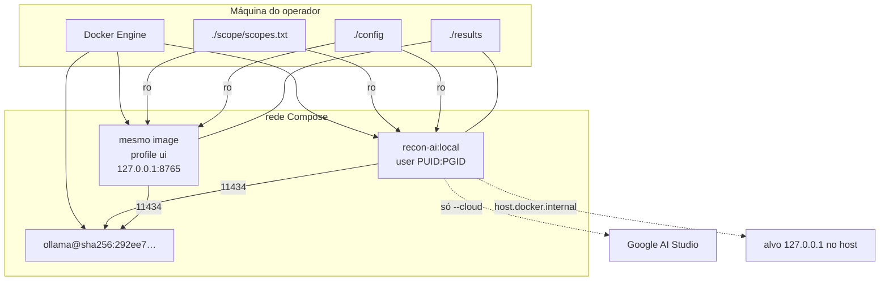

# Deployment

## Host versus container

| Item | Onde corre |
| --- | --- |
| Docker / Compose | Host |
| Ferramentas Go e Nuclei | Container |
| Python orquestrador | Container (`PYTHONPATH=/opt/recon/app`) |
| SQLite e artefatos | Volume `./results` |
| Allowlist | Volume `./scope` (ro) |
| API keys das ferramentas | Volume `./config` (ro), copiadas para `results/state/home` |
| `GEMINI_API_KEY` | Ambiente do processo `recon`/`ui`; nunca no spec nem no git |
| Modelo 4,7 GB | Volume Docker `ollama_data` |
| Compilador Go | Só no estágio de build; a imagem final não o contém |

## amd64 e arm64

O `Dockerfile` usa `TARGETARCH` em `scripts/fetch-tools.sh`. assetfinder e waybackurls compilam no estágio `golang:1.27.1-trixie`. O README da raiz afirma que a prova da segunda arquitetura espera o job `CI`. Existem workflows em `.github/workflows/`; o job `CI` ainda é placeholder. Status: descrito, não verificado no Actions.

## Volumes e usuário

`PUID`/`PGID` (default 1000) para os arquivos em `results/` nascerem com o UID de quem corre o Compose. Sem isso, o container root cria arquivos que o host não apaga com facilidade.

## Perfis

Ver [configuration/profiles.md](../configuration/profiles.md). `ollama` hoje sobe sem profile.
