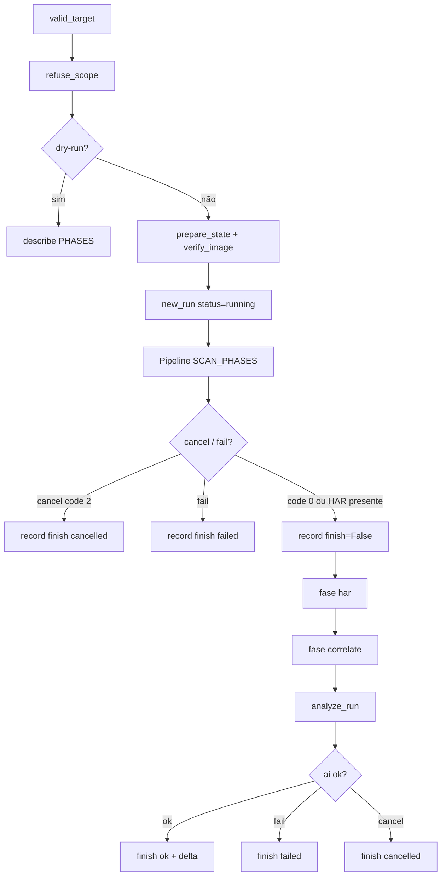

# Fluxo de execução

## Ordem das fases

`SCAN_PHASES`: subdomains → dns → http → urls → dorks → js → nuclei → report.

Depois da coleta: `har` (`skip` se não houver captura; com `.har` corre mesmo se a coleta falhou, excepto cancel). Depois: `correlate` (sempre, 0 findings é `ok`). Depois: `ai`. Sem HAR, a IA só corre se a coleta ficou `ok` (como hoje). Dorks no scan: `--disable dorks` grava `skip`. Falha de `go-dork`/httpx dos hits falha o run.

`--from` / `resume` usa `first_incomplete`: a primeira fase cujo status não é `ok` nem `skip`. Se a coleta está completa, `har`/`correlate` ok ou skip e `ai` falta, retoma só a análise (`from_phase=ai` não recalcula HAR nem correlate). `recon ai RUN_ID` reabre a fase mesmo se já estava `fail`/`ok`; a flag `--cloud` do comando **substitui** o spec (default falso = Ollama).

## Timeouts e retries (código)

| Ferramenta | Timeout / retry no código |
| --- | --- |
| amass | `timeout_minutes` default 5 (`-timeout`) |
| assetfinder | `timeout 180` |
| crt.sh | curl `--max-time 120` |
| httpx | `timeout` 10, `retries` 2 |
| katana | `timeout` 10, `depth` 3 |
| js_httpx | `timeout` 8; lista limitada a 200 URLs |
| js_curl | `--max-time` 15 por URL |
| nuclei | `timeout` 10, `retries` 1, `rate_limit` 150 |
| go-dork | `delay_s` 12 entre queries; `max_queries` 24 |
| Ollama | `timeout=600` s por chamada; sem retry de transporte |
| Gemini | `timeout=600` s; retry em HTTP 429/503 (4 tentativas, 2 s / 4 s / 8 s). Sem fallback para Ollama |

## Persistência

Cada fase grava `running` no SQLite e em `phases.tsv` **antes** dos binários (`_begin`). stderr vai para `logs/<ferramenta>.err`. Cancel envia SIGTERM ao process group.

## Motor Bash

Se `RECON_ENGINE=bash`, `execute` chama `recon-claude-grok.sh` e **não** corre o Pipeline Python. A fase `ai` depois do ingest ainda corre se `run_job` for o caminho Python de controlo — o script Bash não escreve `ai` no TSV. Evidência: `runner.execute`.
