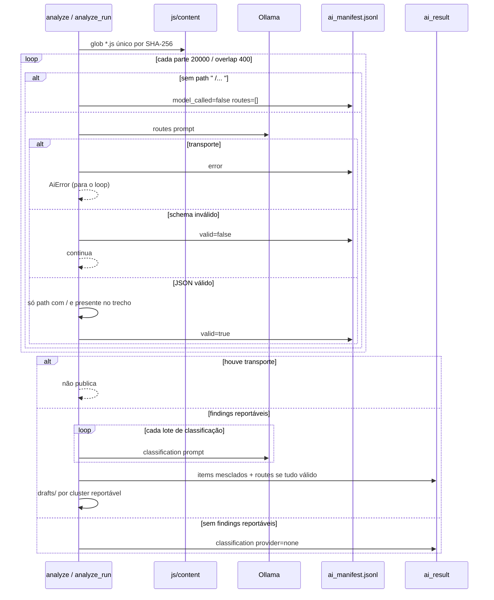
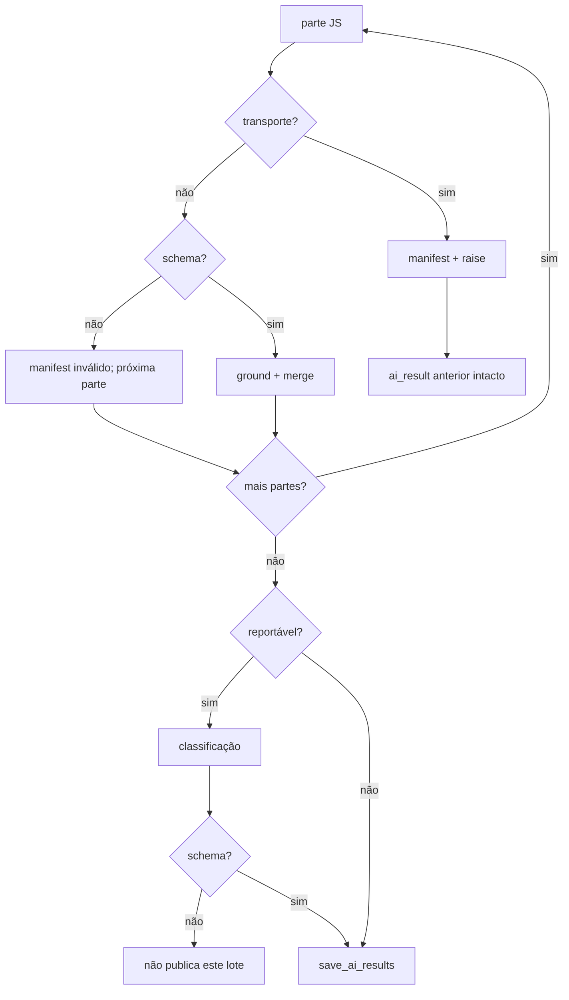

# Sequência JS → IA

Com `--cloud` o participante O é o Google AI Studio (mesmo schema). Sem JS em disco a task de rotas grava `provider=none`.

Erro de schema numa parte **não** apaga o manifest; a publicação em `ai_result` só ocorre se o loop inteiro e a classificação passarem. Erro de transporte encerra. Resultado anterior publicado **não** é apagado nesse caso (`ai.py`).

Fluxo de erro da IA:

