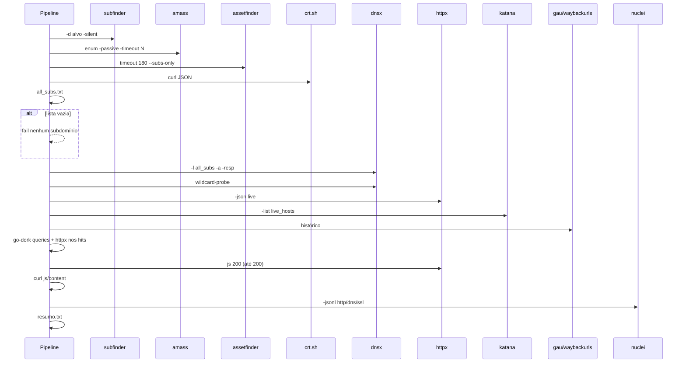

# Sequência da coleta

Alvo literal: subdomains e dns não chamam OSINT; escrevem o próprio host (`test_phase3`). Uma fonte de subdomínio que falha incrementa o contador e a fase fica `warn` se ainda houver nomes.

Depois desta coleta (fora deste diagrama): fase `har` opcional (`iter_har_entries` + nuclei em lotes), `correlate`, depois `ai`.
