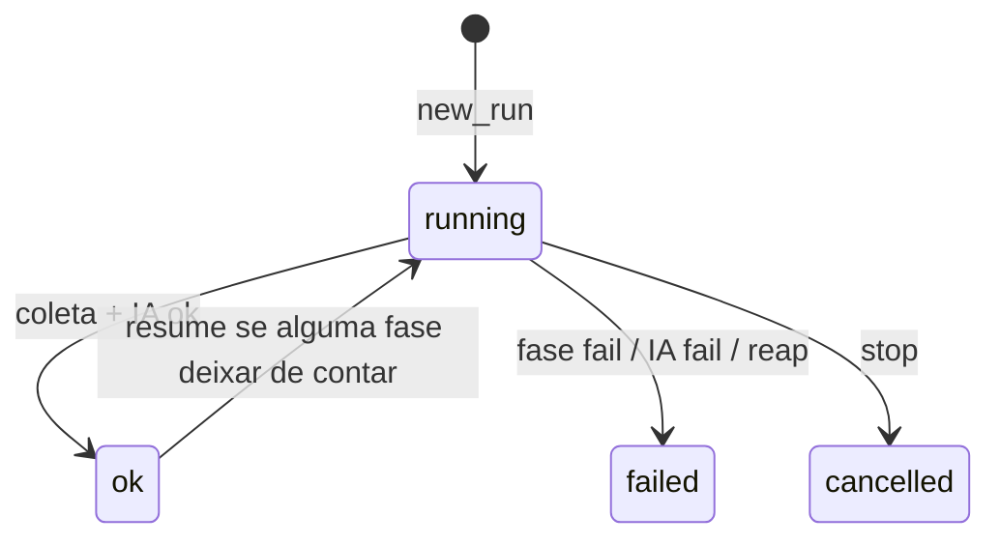

# Ciclo de vida do run

Na prática `ok` não volta atrás sozinho. `resume` reabre o mesmo `run_id` se `first_incomplete` não for `None`. `PHASES` = `SCAN_PHASES` + `har` + `correlate` + `ai`. `from_phase=ai` não recalcula HAR nem correlate se essas fases já estão `ok`/`skip`.

UI: `current_phase` = fase com status `running`. Flow lista todas as `PHASES`; run antigo sem linha `ai` mas com `ai_result` aparece `ai=ok` no view. `SCAN_LOCK` (scan) e `AI_CHAT_LOCK` (Consultar a IA) são independentes; chat livre recusa se houver scan `running`. Reap na subida marca run/fase `running` órfãos. `DELETE` só em run que não está `running`. `recon ai` reabre a fase `ai` no mesmo `run_id` (Ollama, salvo `--cloud`).
